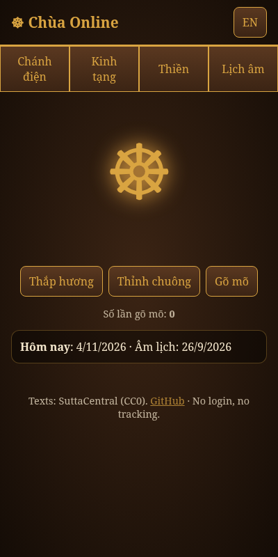
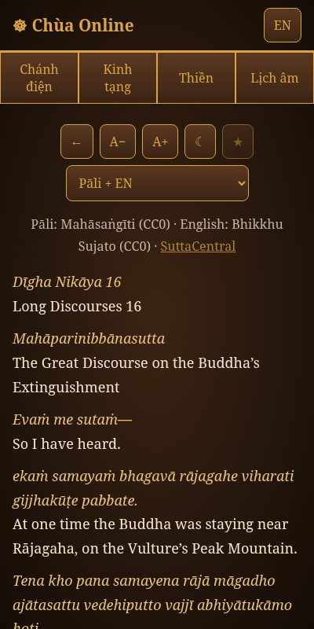
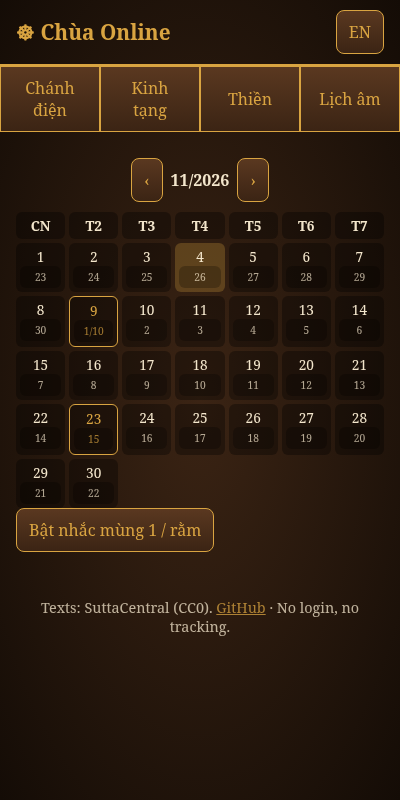

# Pagoda Online · Chùa Online

**Offline-first Buddhist PWA**: a calm virtual pagoda with a sutra library, a meditation timer, bell and wooden fish, an incense offering, and a Vietnamese lunar calendar. UI in Vietnamese and English. No login, no tracking, free and open source.

**Live:** https://vuvietnb85-web.github.io/pagoda-online/

  

## Features
- **Sutra library (Kinh tạng)**: 43 bundled suttas (Pāli + English, CC0), including DN 16, DN 22, DN 31, MN 10, MN 118, SN 56.11, Dhammapada chapters, Karaṇīya Mettā Sutta, Maṅgala Sutta and more. Full-text search.
- **Reader**: font size, night mode, bookmarks, resume at last position, Pāli / English / both modes, and an optional Vietnamese mode (Thích Minh Châu) loaded live from SuttaCentral.
- **Shrine (Chánh điện)**: virtual incense offering, temple bell and wooden fish (mõ) synthesised with Web Audio, with a strike counter.
- **Meditation timer**: 5/10/20/30 minutes with opening and closing bells.
- **Lunar calendar (Lịch âm)**: monthly grid with lunar dates, mùng 1 and rằm highlighted, optional reminders.
- **Offering (Cúng dường)**: voluntary donation that unlocks nothing; every feature stays free. PayPal in USD (main link plus quick amounts 2/5/10/20) and MoMo (0988960419 / +84988960419, amount chips, transfer note, and a client-side QR of the phone number — not an official MoMo QR).
- **PWA**: installable, works offline via a service worker.

## Run locally
```
python3 -m http.server 8080
```

## Inspired by
SuttaCentral (segmented reader, open data), Access to Insight (curated library), Insight Timer and Plum Village apps (meditation bells), and Vietnamese "chùa online" sites (incense offering, lunar 1st/15th).

## Licenses
- Code: [MIT](LICENSE)
- Texts: see [SOURCES.md](SOURCES.md) (Pāli and English CC0 via SuttaCentral; Vietnamese not bundled)
